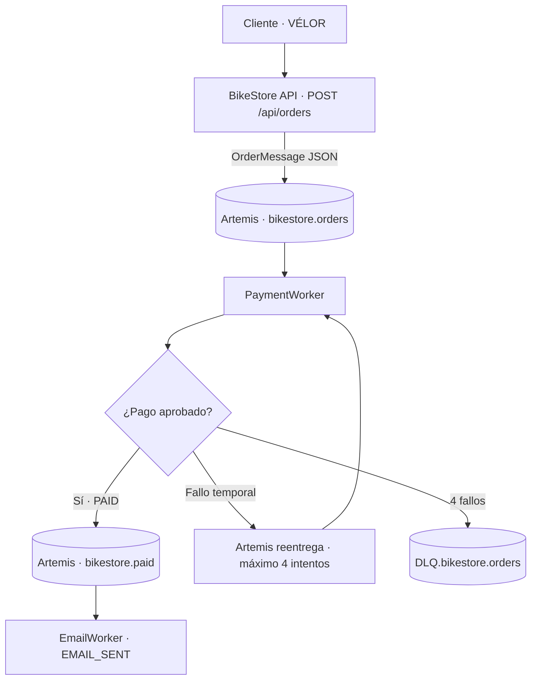
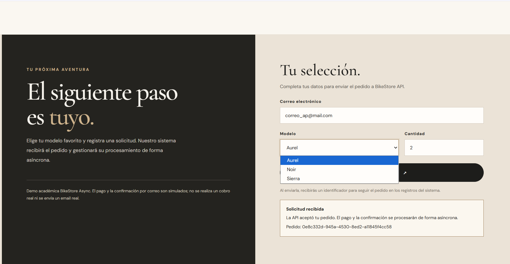
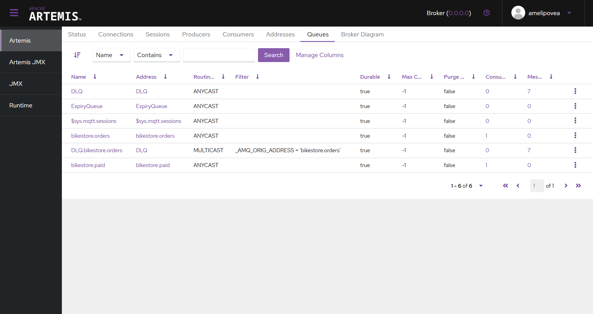
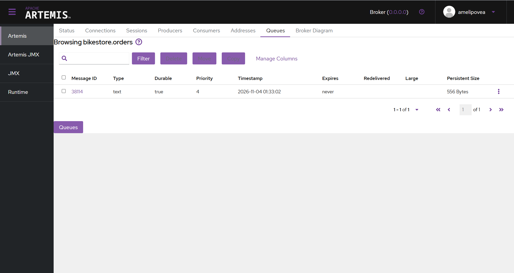
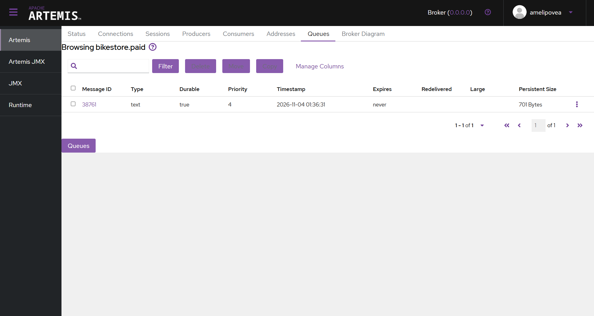
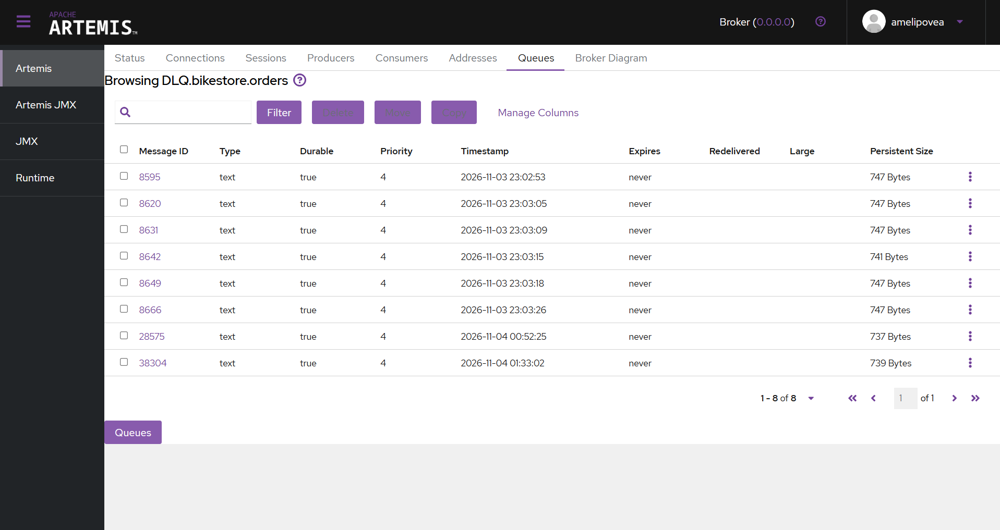

# BikeStore Async — VÉLOR

**Sistema de pedidos de bicicletas con procesamiento asíncrono, Java, Spring Boot y Apache ActiveMQ Artemis.**

En este proyecto desarrollamos una tienda web de bicicletas llamada **VÉLOR**. Su objetivo no es realizar un cobro bancario real, sino demostrar cómo distintas aplicaciones pueden colaborar mediante **mensajes**, sin depender de que todas respondan al mismo tiempo.

La tienda recibe la solicitud, un trabajador simula el pago y un segundo trabajador registra la confirmación únicamente si el pago fue aprobado. Cuando hay problemas, Artemis se encarga de **reintentar el procesamiento** y de **conservar los mensajes que agotaron sus intentos**.


> **Alcance académico:** los pagos son simulados, `EMAIL_SENT` es un registro de confirmación y no un email enviado por SMTP. No se utiliza una base de datos ni una pasarela de pagos real. Las fotografías de esta sección se generaron a partir del frontend del proyecto; las evidencias de Artemis y de las terminales deben capturarse durante una ejecución real.

## Contenido

1. [Objetivo y tecnologías](#objetivo-y-tecnologías)
2. [¿Por qué elegimos Artemis?](#por-qué-elegimos-artemis)
3. [Arquitectura y recorrido de un pedido](#arquitectura-y-recorrido-de-un-pedido)
4. [¿Qué sucede si falla un pago?](#qué-sucede-si-falla-un-pago)
5. [Estructura del repositorio](#estructura-del-repositorio)
6. [Cómo ejecutar el proyecto en Windows](#cómo-ejecutar-el-proyecto-en-windows)
7. [Cómo probar el sistema](#cómo-probar-el-sistema)
8. [Frontend y evidencias](#frontend-y-evidencias)
9. [Capturas de Artemis: colas y módulos](#capturas-de-artemis-colas-y-módulos)
10. [Limitaciones y posibles mejoras](#limitaciones-y-posibles-mejoras)
11. [Referencias](#referencias)

## Objetivo y tecnologías

Queríamos resolver un caso sencillo: una persona elige una bicicleta, registra un pedido y recibe una confirmación **después** de que el sistema procese su pago. En lugar de realizar todo en una sola petición HTTP, separamos el trabajo en servicios especializados.

| Tecnología | Uso en el proyecto |
| --- | --- |
| **Java 17** | Lenguaje de los servicios y de los contratos de mensajes. |
| **Spring Boot 4.1.2** | Inicio de aplicaciones, API REST e integración con JMS. |
| **Apache ActiveMQ Artemis 2.57.0** | Broker que distribuye, conserva y reentrega los mensajes. |
| **JMS (Jakarta Messaging)** | Envío y recepción de mensajes desde Java. |
| **Docker Compose** | Ejecución del broker con una configuración reproducible. |
| **Maven Wrapper** | Compilación de todos los módulos y ejecución de pruebas. |
| **HTML, CSS y JavaScript** | Interfaz de la tienda VÉLOR, servida por BikeStore API. |
| **JUnit y Mockito** | Pruebas unitarias del comportamiento de los trabajadores. |

La API devuelve **HTTP 202 Accepted** cuando acepta el pedido para su procesamiento. **Eso no significa que el pago ya esté aprobado.** El procesamiento ocurre después, mediante mensajes asíncronos.

## ¿Por qué elegimos Artemis?

Al diseñar el proyecto necesitábamos algo más que enviar datos entre dos programas. Buscábamos un intermediario capaz de recibir pedidos aunque los trabajadores no estén disponibles en ese instante, reintentar operaciones fallidas y separar los mensajes recuperables de los definitivamente fallidos.

**Apache ActiveMQ Artemis fue la elección adecuada para este ejercicio por cinco motivos:**

1. **Colas y consumo desacoplado.** La API publica un pedido en `bikestore.orders` y puede responder sin esperar el resultado de PaymentWorker. La aplicación que recibe el pedido no necesita conocer la dirección HTTP de ningún trabajador.
2. **Integración con Java y JMS.** Spring Boot permite usar `JmsTemplate` para publicar y `@JmsListener` para consumir. Así implementamos mensajería sin crear un protocolo de comunicación propio.
3. **Reintentos configurables en el broker.** Los límites y retrasos de entrega se definen en `broker.xml`, en lugar de depender de un ciclo de reintentos escrito manualmente en cada servicio.
4. **Dead Letter Queue (DLQ).** Cuando un pedido falla repetidamente, Artemis puede trasladarlo a una cola especial para inspeccionarlo, sin bloquear indefinidamente el procesamiento de los demás pedidos.
5. **Observabilidad.** La consola de Artemis permite examinar direcciones, colas, contadores y mensajes. Fue especialmente útil para verificar visualmente los seis pedidos enviados a `DLQ.bikestore.orders` durante la prueba de fallo forzado.

### Comparación con otras dos alternativas

No consideramos que Artemis sea superior en todos los escenarios. La elección depende del tipo de aplicación.

| Criterio | ActiveMQ Artemis | RabbitMQ | Apache Kafka |
| --- | --- | --- | --- |
| Enfoque principal | Mensajería mediante direcciones y colas; integración JMS. | Mensajería y enrutamiento flexible mediante exchanges y colas. | Plataforma de eventos persistentes organizada en topics y particiones. |
| Patrón que nos interesa | Una cola de pedidos y otra de pagos confirmados. | También resuelve colas de trabajo; habría sido una alternativa válida. | Destaca cuando necesitamos conservar y reprocesar flujos de eventos a gran escala. |
| Fallos y reintentos | `max-delivery-attempts`, `redelivery-delay` y DLQ configurados en el broker. | Acknowledgements, dead lettering y estrategias de reentrega. | Reprocesamiento mediante offsets y políticas de consumidores. |
| Integración elegida | Encaje directo con Java, Spring JMS y `@JmsListener`. | Posible con Spring AMQP, pero requeriría otro modelo de configuración. | Requeriría introducir productores, consumidores y gestión de offsets. |
| Decisión para BikeStore | **Elegido:** permite demostrar el objetivo académico con una configuración breve y verificable. | **Viable:** también serviría, aunque supondría implementar otra topología. | **No elegido:** sus ventajas de streaming no eran necesarias para este flujo pequeño de pedidos. |

En definitiva, elegimos **Artemis por adecuación al problema**, no por una afirmación de rendimiento absoluto: el caso pide mensajería asíncrona, reintentos, DLQ y una integración sencilla con Java.

## Arquitectura y recorrido de un pedido



### Responsabilidad de cada aplicación

**BikeStore API — recibe y publica.** El frontend envía un `POST /api/orders` con correo, bicicleta y cantidad. La API valida los datos, genera un `pedidoId`, construye un `OrderMessage` en JSON y lo publica en `bikestore.orders`. Después responde con `status: ACCEPTED`.

**PaymentWorker — procesa el pago simulado.** Escucha `bikestore.orders`. En cada entrega simula una decisión con **50 % de probabilidad de fallo**. Si falla, lanza una excepción que hace retroceder la recepción JMS transaccional. Si se aprueba, publica un `PaymentResult` con `paymentStatus: PAID` en `bikestore.paid`.

**EmailWorker — confirma pedidos aprobados.** Escucha `bikestore.paid`, revisa que el estado sea `PAID` y registra `EMAIL_SENT` con el mismo `pedidoId`. No consume directamente la cola de pedidos ni confirma los que terminaron en la DLQ.

**Contracts — lenguaje común.** Los `record` `OrderMessage` y `PaymentResult` establecen la estructura compartida de los mensajes, evitando que cada módulo invente campos diferentes.

### Ejemplo de pedido

```json
{
  "customerEmail": "cliente@example.com",
  "bikeModel": "Aurel",
  "quantity": 1
}
```

Respuesta HTTP `202`:

```json
{
  "pedidoId": "550e8400-e29b-41d4-a716-446655440000",
  "status": "ACCEPTED"
}
```

El identificador mostrado es ilustrativo. En una ejecución real se genera un identificador nuevo para cada pedido.

### ¿Por qué esta solución es asíncrona y orientada a servicios?

Cada servicio tiene una responsabilidad independiente. La API no ejecuta el pago; PaymentWorker no genera páginas web; EmailWorker no decide si un pago es válido. El intercambio se hace mediante contratos JSON y destinos de mensajería. Es una aplicación de **separación de responsabilidades y comunicación orientada a mensajes**, coherente con los principios de SOA y con arquitecturas dirigidas por eventos.

## ¿Qué sucede si falla un pago?

La regla de pruebas del sistema es **un intento inicial y hasta tres reintentos adicionales**, es decir, **cuatro entregas como máximo**.

La configuración comprobada en `config/broker.xml` es:

```xml
<address-setting match="bikestore.orders">
    <dead-letter-address>DLQ</dead-letter-address>
    <auto-create-dead-letter-resources>true</auto-create-dead-letter-resources>
    <max-delivery-attempts>4</max-delivery-attempts>
    <redelivery-delay>750</redelivery-delay>
</address-setting>
```

`redelivery-delay=750` solicita esperar aproximadamente **750 ms** antes de un nuevo intento. `max-delivery-attempts=4` limita las entregas. La DLQ almacena los mensajes que agotaron ese máximo.

| Situación | Qué ocurre | Resultado |
| --- | --- | --- |
| Pago aprobado en el primer intento | PaymentWorker registra `PAYMENT_PAID` y publica `PAID`. | EmailWorker registra `EMAIL_SENT`. |
| Pago fallido inicialmente, aprobado en un reintento | Artemis vuelve a entregar el mismo pedido; el identificador se conserva. | También termina con `EMAIL_SENT`. |
| Cuatro intentos fallidos | Se agotan las entregas permitidas. | Artemis traslada el mensaje a `DLQ.bikestore.orders`; no se envía confirmación. |
| EmailWorker detenido | Los pagos pueden procesarse independientemente y dejar eventos pendientes en `bikestore.paid`. | Al volver a iniciarse el consumidor, puede recibir esos mensajes. |

La propiedad JMS `JMSXDeliveryCount` permite observar la secuencia `1 → 2 → 3 → 4` en los registros. Cada fallo revierte la recepción; el broker decide cuándo volver a entregar y cuándo mover el mensaje a la DLQ. Esto impide un bucle infinito de pedidos fallidos.

El modo aleatorio no garantiza que cada segundo pedido falle: la probabilidad se calcula **en cada intento**. Por ejemplo, cuatro fallos consecutivos tienen una probabilidad teórica de `0,5⁴ = 6,25 %`, suponiendo intentos independientes. Por eso creamos también un modo de prueba determinista con `--bikestore.payment.force-failure=true`.

> **Evidencia observada:** al activar el fallo forzado y enviar seis pedidos, los registros mostraron `PAYMENT_ATTEMPT`, `PAYMENT_FAILED` y `RETRIES_EXHAUSTED`; la consola de Artemis mostró **seis mensajes en `DLQ.bikestore.orders`**. En la prueba normal se observaron aprobaciones en los intentos 1, 2 y 3, y el posterior `EMAIL_SENT`.

## Estructura del repositorio

```text
bikestore-artemis/
├── pom.xml                        # Proyecto Maven multimódulo
├── mvnw.cmd                       # Maven Wrapper para Windows
├── compose.yaml                   # Broker Artemis en Docker
├── .env.example                   # Variables de entorno de ejemplo
├── config/
│   └── broker.xml                 # Política de reintentos y DLQ
├── contracts/
│   └── src/main/java/com/bikestore/contracts/
│       ├── OrderMessage.java
│       └── PaymentResult.java
├── bikestore-api/
│   └── src/main/
│       ├── java/com/bikestore/api/
│       └── resources/static/index.html   # Frontend VÉLOR
├── payment-worker/
│   └── src/main/java/com/bikestore/payments/
├── email-worker/
│   └── src/main/java/com/bikestore/email/
└── docs/
    ├── GUIA_DE_EVIDENCIAS.md
    └── capturas/
```

## Cómo ejecutar el proyecto en Windows

**Requisitos:** Java 17 compatible con el proyecto, Docker Desktop encendido, PowerShell y los archivos de este repositorio. Los puertos locales utilizados son **8080** (web/API), **61616** (mensajería Artemis) y **8161** (consola Artemis).

### 1. Preparar el entorno

Desde la carpeta del repositorio:

```powershell
cd C:\AME\JAVA\bikestore-artemis

# Solo la primera vez, si todavía no existe .env:
if (-not (Test-Path .env)) { Copy-Item .env.example .env }
```

Edita `.env` con tus credenciales de desarrollo. **No subas `.env` a GitHub.** Esas credenciales se cargan en cada terminal de PowerShell que vaya a ejecutar una aplicación Java:

```powershell
Get-Content .\.env | ForEach-Object {
    if ($_ -match '^\s*(ARTEMIS_USER|ARTEMIS_PASSWORD)\s*=\s*(.*)\s*$') {
        $clave = $Matches[1]
        $valor = $Matches[2].Trim().Trim('"').Trim("'")
        [Environment]::SetEnvironmentVariable($clave, $valor, 'Process')
    }
}
```

### 2. Iniciar Apache ActiveMQ Artemis

```powershell
docker compose config --quiet
docker compose up -d artemis
docker compose ps
```

Abre la consola de administración en **http://localhost:8161/console** e inicia sesión con las credenciales configuradas localmente.

**Verificar la política activa:**

```powershell
docker compose exec -T artemis cat /var/lib/artemis-instance/etc/broker.xml |
    Select-String 'bikestore.orders' -Context 0,7
```

Debe mostrarse la regla de cuatro entregas y el retraso de 750 ms. El proyecto monta `config/` en `etc-override`; si trabajas con una instancia antigua de Artemis y la regla no aparece en el archivo **activo**, conserva los datos del broker y revisa la sincronización de configuración antes de hacer pruebas. No uses `docker compose down -v` si quieres preservar los mensajes almacenados.

### 3. Compilar

Detén cualquier JAR del proyecto que esté ejecutándose antes de compilar en Windows, porque `clean` no puede borrar un JAR abierto.

```powershell
.\mvnw.cmd -DskipTests clean package
```

Este comando verifica la compilación y genera los JAR, **pero omite las pruebas automatizadas**.

### 4. Ejecutar las tres aplicaciones

Abre **tres terminales de PowerShell** en la raíz del proyecto. En cada una carga antes las variables de `.env` con el bloque del paso 1.

**Terminal A — BikeStore API:**

```powershell
java -jar .\bikestore-api\target\bikestore-api-0.0.1-SNAPSHOT.jar
```

**Terminal B — PaymentWorker:**

```powershell
java -jar .\payment-worker\target\payment-worker-0.0.1-SNAPSHOT.jar
```

**Terminal C — EmailWorker:**

```powershell
java -jar .\email-worker\target\email-worker-0.0.1-SNAPSHOT.jar
```

Abre **http://localhost:8080** y prueba el catálogo VÉLOR. Desde la web se puede seleccionar Aurel, Noir o Sierra, revisar sus detalles y enviar un pedido.

## Cómo probar el sistema

### Prueba A — Pedido exitoso de extremo a extremo

También puedes enviar un pedido desde una cuarta terminal PowerShell:

```powershell
$pedido = @{
    customerEmail = 'cliente@example.com'
    bikeModel = 'Aurel'
    quantity = 1
} | ConvertTo-Json

$bytes = [System.Text.Encoding]::UTF8.GetBytes($pedido)

$respuesta = Invoke-RestMethod `
    -Uri 'http://localhost:8080/api/orders' `
    -Method Post `
    -ContentType 'application/json; charset=utf-8' `
    -Body $bytes

$respuesta
```

Guarda el `pedidoId`. En la terminal de la API debe aparecer `ORDER_PUBLISHED`. En PaymentWorker verás `PAYMENT_ATTEMPT` y, si se aprueba, `PAYMENT_PAID` y `PAYMENT_EVENT_PUBLISHED`. En EmailWorker debe aparecer `EMAIL_SENT` con **el mismo `pedidoId`**.

Si este pedido falla los cuatro intentos, es un resultado válido del modo aleatorio; envía otro para comprobar la ruta aprobada.

### Prueba B — Forzar cuatro fallos y observar la DLQ

1. Detén **solamente PaymentWorker** con `Ctrl + C`.
2. Comprueba que `bikestore.orders` no tenga pedidos pendientes importantes: el modo forzado fallará **todos** los pedidos que consuma.
3. Reinícialo así, en la terminal donde ya están cargadas las credenciales:

```powershell
java -jar .\payment-worker\target\payment-worker-0.0.1-SNAPSHOT.jar --bikestore.payment.force-failure=true
```

4. Envía un pedido desde la web o PowerShell.
5. Comprueba los registros del mismo pedido:

```text
pedidoId=... evento=PAYMENT_ATTEMPT intento=1
pedidoId=... evento=PAYMENT_FAILED intento=1
pedidoId=... evento=PAYMENT_ATTEMPT intento=2
pedidoId=... evento=PAYMENT_FAILED intento=2
pedidoId=... evento=PAYMENT_ATTEMPT intento=3
pedidoId=... evento=PAYMENT_FAILED intento=3
pedidoId=... evento=PAYMENT_ATTEMPT intento=4
pedidoId=... evento=PAYMENT_FAILED intento=4
pedidoId=... evento=RETRIES_EXHAUSTED
```

6. En **http://localhost:8161/console**, entra a **Queues** y navega a `DLQ.bikestore.orders`. Usa **Browse** para examinar el mensaje sin borrarlo.
7. Detén PaymentWorker y vuelve a iniciarlo **sin** `--bikestore.payment.force-failure=true`.

Los mensajes almacenados en la DLQ son evidencia de los errores agotados. **No hace falta purgar la cola para probar un pedido exitoso**.

### Prueba C — Pruebas automatizadas con Maven

Se crearon pruebas unitarias con JUnit y Mockito para comprobar el fallo forzado de PaymentWorker, el registro de confirmación para `PAID` y la ausencia de confirmación para `FAILED`.

```powershell
.\mvnw.cmd test
```

Para consultar los informes:

```powershell
Get-ChildItem .\payment-worker\target\surefire-reports\*.txt, `
              .\email-worker\target\surefire-reports\*.txt |
    ForEach-Object { Get-Content $_.FullName | Select-String 'Tests run:' }
```

**Estado de verificación:** la compilación `-DskipTests clean package` se observó con `BUILD SUCCESS`. Los archivos de tres pruebas unitarias se crearon, pero **todavía no se ha aportado un resultado de `mvnw.cmd test`**; por tanto, no afirmamos aquí que estén aprobadas. Se debe añadir la captura del resultado real después de ejecutarlas.

## Frontend y evidencias

El frontend VÉLOR está integrado en `bikestore-api/src/main/resources/static/index.html`. Se construyó con una estética editorial de tonos marfil y negro, catálogo de bicicletas y un panel de detalles que permite elegir un modelo antes de enviar el pedido.

| Detalle de bicicleta | Formulario de pedido |
| --- | --- |
|  |  |


### Evidencia del backend que debe agregarse

Las capturas del backend deben realizarse **en el equipo donde se ejecuta Spring Boot y Artemis**, para que contengan los datos reales de la prueba. La guía [docs/GUIA_DE_EVIDENCIAS.md](docs/GUIA_DE_EVIDENCIAS.md) indica exactamente qué pantalla abrir, qué comando ejecutar y cómo nombrar cada archivo.

**Capturas recomendadas:** API con `ORDER_PUBLISHED`, PaymentWorker con pago aprobado, EmailWorker con `EMAIL_SENT`, PaymentWorker con los cuatro fallos, consola Artemis mostrando los mensajes de `DLQ.bikestore.orders` y resultado de `mvnw.cmd test`.

No se incluyen aquí imágenes inventadas de terminales ni resultados falsificados. Cuando las agregues a `docs/capturas`, puedes enlazarlas desde esta sección.

## Capturas de Artemis: colas y módulos

Esta sección reúne las **evidencias visuales del broker** para identificar dónde queda cada mensaje, quién lo publica y quién lo consume. No se crea una cola distinta por cada programa: **los servicios comparten destinos de mensajería** y se conectan a ellos mediante sus productores y consumidores JMS.

| Módulo | Función | Destino que se debe mostrar en Artemis | Qué demuestra |
| --- | --- | --- | --- |
| **BikeStore API** | Publica pedidos `OrderMessage` | `bikestore.orders` | El pedido ingresó al broker para ser procesado de forma asíncrona. |
| **PaymentWorker** | Consume pedidos y, si aprueba el pago, publica `PaymentResult` | `bikestore.orders` y `bikestore.paid` | Hay una transición desde el pedido recibido al evento de pago aprobado. |
| **EmailWorker** | Consume eventos `PAID` | `bikestore.paid` | La confirmación se basa en el resultado del pago, no en la solicitud original. |
| **Artemis (gestión de fallos)** | Almacena pedidos que agotaron sus intentos | `DLQ.bikestore.orders` | Los mensajes fallidos no se pierden ni se confirman por error. |

>

### 1. Vista general: las colas del sistema




### 2. BikeStore API → `bikestore.orders` → PaymentWorker




### 3. PaymentWorker → `bikestore.paid` → EmailWorker




### 4. Mensajes agotados → `DLQ.bikestore.orders`




## Limitaciones y posibles mejoras

Este proyecto es una demostración académica, no una tienda lista para producción. Todavía quedan fuera del alcance el cobro real, el envío de emails por SMTP, la autenticación, la persistencia de pedidos en una base de datos, los precios reales y las integraciones de inventario.

Como evolución proponemos **idempotencia por `pedidoId`**, estados persistidos de pedido, validaciones más completas, una API para consultar el estado del pago, métricas de salud y pruebas de integración automatizadas que arranquen Artemis en un entorno controlado. La mensajería transaccional ayuda a coordinar consumo y publicación JMS, pero por sí sola **no ofrece una transacción distribuida con un proveedor bancario externo**.

## Referencias

- [Documentación oficial de Apache ActiveMQ Artemis — Modelo de direcciones y colas](https://artemis.apache.org/components/artemis/documentation/latest/address-model.html).
- [Apache ActiveMQ Artemis — Reintentos y Dead Letter Addresses](https://artemis.apache.org/components/artemis/documentation/latest/undelivered-messages.html).
- [Apache ActiveMQ Artemis — Docker](https://artemis.apache.org/components/artemis/documentation/latest/docker.html).
- [RabbitMQ — Confirmaciones y acknowledgements](https://www.rabbitmq.com/docs/confirms).
- [Apache Kafka — Introducción](https://kafka.apache.org/intro/).

